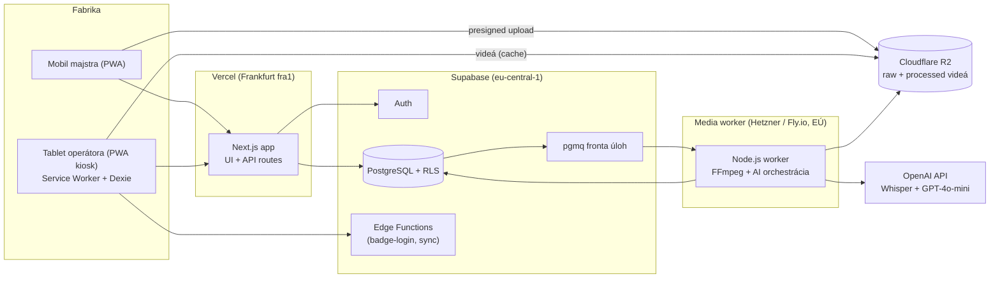
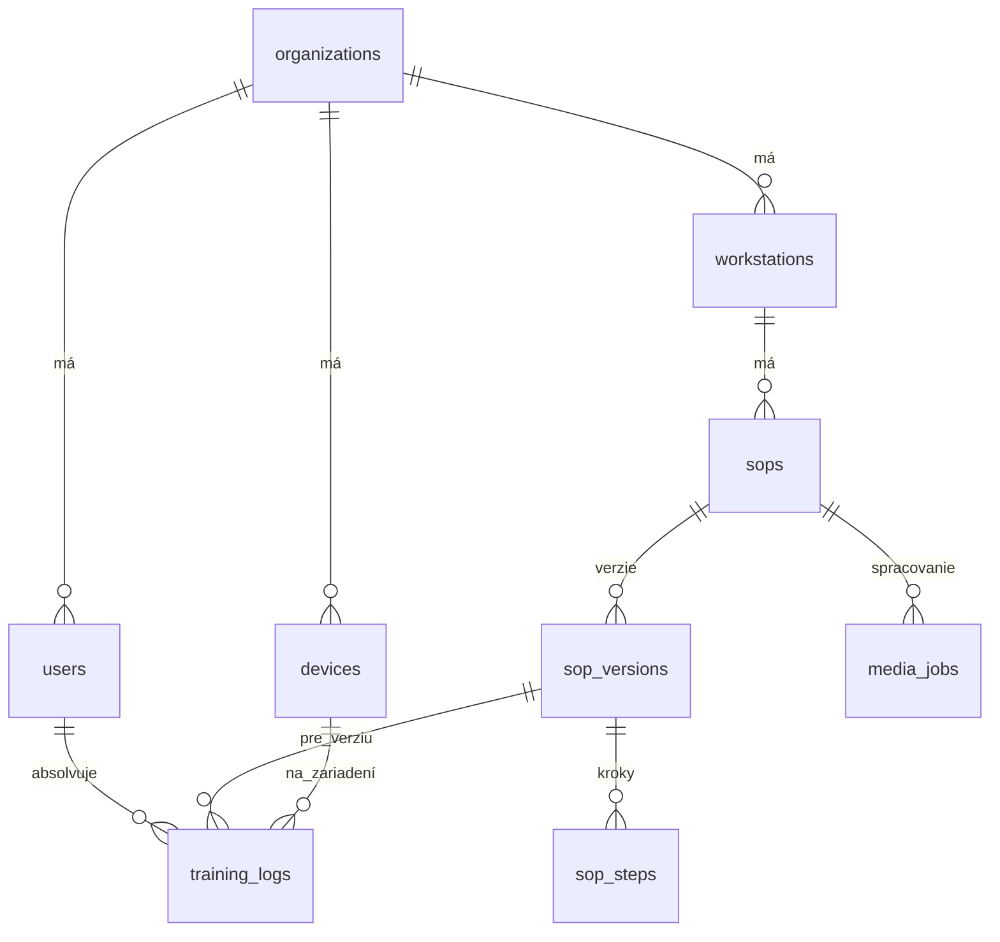
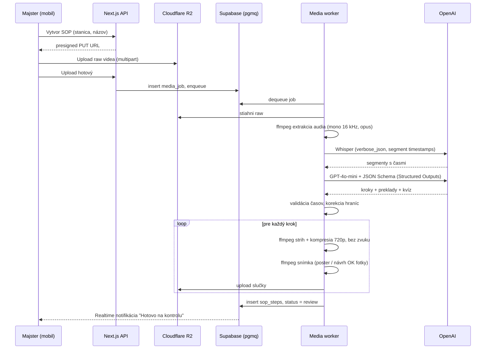
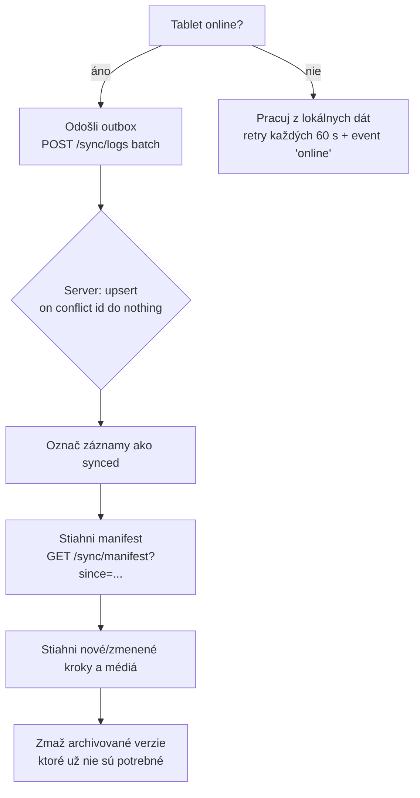

# Technická a systémová analýza – MVP priemyselnej onboardingovej platformy

> Pracovný názov: **SOP Kiosk** · Verzia dokumentu: 1.0 · Dátum: 17. 10. 2026
> Rozsah: MVP pre 1 fabriku / 1 linku, tím 1 – 2 vývojári, 8 týždňov

---

## 0. Zhrnutie

| Oblasť | Rozhodnutie | Hodnotenie |
|---|---|---|
| Typ produktu | Multi-tenant B2B SaaS, PWA (bez natívnych aplikácií) | ✅ Správne |
| Stack | Next.js + Tailwind, Supabase (Postgres, Auth, RLS), Dexie.js | ✅ Správne |
| Offline | Service Worker + IndexedDB, synchronizácia cez outbox | ⚠️ Najväčšie technické riziko – treba navrhnúť dôkladne |
| AI pipeline | Whisper → LLM (štruktúrovaný JSON) → FFmpeg | ✅ Realizovateľné, ⚠️ FFmpeg nebeží na Verceli |
| Rozpočet | „Do 550 €" | ⚠️ Mierne podhodnotený (Vercel Hobby nie je na komerčné použitie, FFmpeg worker) – reálne **~600 – 700 €** |
| Harmonogram | 8 týždňov | ⚠️ Napätý, ale reálny pri prísnom zúžení rozsahu (pozri kap. 10) |
| GDPR / IT bezpečnosť | Dáta v EÚ, guest Wi-Fi | ⚠️ OpenAI spracúva štandardne mimo EÚ – treba to komunikovať pravdivo (kap. 9) |

**Záver:** Koncept je technicky zdravý a ekonomicky veľmi efektívny. Pred štartom treba doriešiť 5 vecí:
1. kde bude bežať FFmpeg,
2. ako sa operátor autentifikuje voči RLS bez e-mailu,
3. synchronizačný model offline logov,
4. verziovanie SOP kvôli auditu,
5. pravdivé tvrdenie o lokalite spracovania AI.

---

## 1. Cieľ a rozsah MVP

### 1.1 Problém
Zaškoľovanie nových (často zahraničných) operátorov vo výrobe stojí majstrov veľa času. Papierové SOP sú zastarané, jazykovo nezrozumiteľné a bez dôkazu o zaškolení.

### 1.2 Cieľ MVP
Overiť na **1 linke v 1 fabrike**, že:
- majster vytvorí SOP z 45 s videa za **< 10 minút** (vrátane kontroly),
- operátor prejde zaškolením v rodnom jazyku **bez pomoci majstra**,
- systém funguje pri výpadku Wi-Fi,
- vznikne auditovateľný protokol o zaškolení (PDF).

### 1.3 V rozsahu (IN)
- Webové rozhranie majstra/admina (SOP builder, editor, správa ľudí a staníc, reporty).
- Tabletové kiosk rozhranie operátora (prihlásenie, prehrávač krokov, kvíz, SOS).
- AI pipeline (prepis, štruktúrovanie, preklad do SK/UK/SR/EN, strih videa).
- Offline režim pre prehrávanie a zber logov.
- PDF protokol o zaškolení.

### 1.4 Mimo rozsahu (OUT) – zámerne
- Natívne aplikácie, integrácia s ERP/MES/HR systémami, SSO (Azure AD).
- Platobná brána a self-service registrácia (fabrika sa zakladá manuálne).
- Pokročilá analytika, gamifikácia, certifikačné expirácie.
- Offline *tvorba* SOP (tvorba vyžaduje sieť).

---

## 2. Aktéri a roly

| Rola | Zariadenie | Prihlásenie | Hlavné činnosti |
|---|---|---|---|
| **Admin** (vedúci výroby / HR) | PC | e-mail + heslo | správa organizácie, používateľov, staníc, reporty, export PDF |
| **Foreman** (majster) | mobil + PC | e-mail + heslo (alebo magic link) | natáča video, kontroluje/edituje AI výstup, publikuje SOP |
| **Operator** | zdieľaný tablet pri linke | NFC karta / QR menovka | absolvuje SOP, kvíz, volá SOS |
| **Device** (tablet) | tablet | párovací kód (jednorazovo) | technická identita kiosku, drží offline cache |
| **Super-admin** (vy) | PC | e-mail + MFA | zakladanie organizácií, podpora |

> [!IMPORTANT]
> Zavádzam rolu **Device** – v pôvodnom návrhu chýba. Tablet je zdieľaný, operátori sa na ňom striedajú. Tablet musí mať vlastnú dlhodobú identitu viazanú na organizáciu (a ideálne na pracovnú stanicu), inak nevieme bezpečne overiť NFC/QR odznak offline.

---

## 3. Funkčné požiadavky

### 3.1 Majster / Admin (web)
| ID | Požiadavka | Priorita |
|---|---|---|
| F-01 | Prihlásenie e-mail/heslo, reset hesla | Must |
| F-02 | CRUD pracovných staníc + generovanie a tlač QR štítku stanice | Must |
| F-03 | CRUD operátorov + generovanie/tlač QR menovky, priradenie NFC karty („pípni kartu pre spárovanie") | Must |
| F-04 | Nahratie videa z mobilu (priamo z kamery cez `<input capture>`), resumable upload | Must |
| F-05 | Stav spracovania (nahrávam → prepisujem → štruktúrujem → strihám → hotovo / chyba) | Must |
| F-06 | Editor krokov: úprava textu po jazykoch, posun hraníc krokov (start/end), zmena poradia, zmazanie/spojenie krokov | Must |
| F-07 | Nahradenie / doplnenie fotky OK a NOK (fotka z mobilu) | Must |
| F-08 | Úprava kvízovej otázky | Must |
| F-09 | Publikovanie SOP → vznik novej nemennej verzie | Must |
| F-10 | Prehľad zaškolení (kto, čo, kedy, skóre, čas na krok, SOS) | Must |
| F-11 | Export PDF protokolu o zaškolení | Must |
| F-12 | Notifikácia majstrovi pri SOS (MVP: zvuk/vizuál na tablete + e-mail/Push) | Should |
| F-13 | Opätovné spracovanie kroku (re-generate) | Could |

### 3.2 Operátor (tablet – kiosk)
| ID | Požiadavka | Priorita |
|---|---|---|
| F-20 | Prihlásenie pípnutím NFC karty alebo QR menovkou (bez klávesnice) | Must |
| F-21 | Automatický výber jazyka podľa `preferred_lang`, prepnutie vlajkou | Must |
| F-22 | Výber SOP – tablet je viazaný na stanicu, alebo naskenovanie QR stanice | Must |
| F-23 | Prehrávač kroku: video slučka + nadpis + 3 odrážky + bezpečnostné upozornenie | Must |
| F-24 | Ovládanie: Ďalej / Späť / SOS (veľké tlačidlá) | Must |
| F-25 | Fotokvíz OK vs. NOK (výber A/B) a kontrolná otázka (3 možnosti) | Must |
| F-26 | Záverečná obrazovka + „Podpis" (potvrdenie tlačidlom, ideálne druhým pípnutím karty) | Must |
| F-27 | Automatické odhlásenie po nečinnosti (napr. 90 s) | Must |
| F-28 | Plná funkčnosť bez siete pre už stiahnuté SOP | Must |
| F-29 | Indikátor stavu synchronizácie (online / offline / X záznamov čaká) | Should |
| F-30 | Hlasový výstup inštrukcie (TTS) | Could |

---

## 4. Nefunkčné požiadavky

| Kategória | Požiadavka | Merateľné kritérium |
|---|---|---|
| Offline | Prehranie publikovaného SOP bez siete | 100 % krokov dostupných offline po synchronizácii |
| Výkon | Prechod medzi krokmi | < 300 ms (video z lokálnej cache) |
| Výkon | Spracovanie 45 s videa | < 3 min end-to-end |
| Veľkosť | Video na krok | ≤ 2 MB (720p, H.264, bez zvuku, CRF ~30) |
| Kapacita tabletu | Lokálna cache | cieľ ≤ 2 GB na tablet (≈ 100 SOP × 8 krokov) |
| UX | Dotykové ciele | min. 64 × 64 px, rozostupy ≥ 16 px (odporúčam 80 px pre hrubé rukavice) |
| UX | Kontrast | WCAG AAA (≥ 7:1) pre text |
| Dostupnosť | Cloud | 99,5 % (stačí – kiosk funguje offline) |
| Bezpečnosť | Izolácia tenantov | RLS na všetkých tabuľkách, automatizované testy izolácie |
| Audit | Nemennosť záznamov | training_logs iba INSERT, bez UPDATE/DELETE pre bežné roly |
| Lokalita dát | DB + storage | EÚ (Frankfurt) |
| Prehliadač | Kiosk | Chrome pre Android ≥ 120 (Web NFC funguje **iba** v Chrome na Androide) |

---

## 5. Architektúra

### 5.1 Prehľad komponentov



### 5.2 Tech stack (finálny)

| Vrstva | Technológia | Poznámka / zmena oproti zadaniu |
|---|---|---|
| Frontend | Next.js 15 (App Router) + Tailwind CSS | Jedna kódová báza, dve „aplikácie": `/app` (majster) a `/kiosk` (tablet) |
| PWA | Serwist (nástupca next-pwa) / Workbox | Precache app shellu, runtime cache API |
| Offline DB | Dexie.js (IndexedDB) | SOP, kroky, odznaky, outbox logov, **video bloby** |
| Backend | Supabase (Postgres, Auth, Storage pre fotky, Edge Functions) | NestJS **netreba** – zbytočne by predĺžil vývoj |
| Fronta úloh | `pgmq` (Supabase Queues) | Bez ďalšej infraštruktúry (žiadny Redis) |
| Media worker | Node.js + `ffmpeg` v Dockeri na Hetzner CX22 (~4,5 €/mes.) alebo Fly.io | ⚠️ **Nové** – FFmpeg nebeží spoľahlivo na Vercel serverless (limity času, veľkosti, binárky) |
| Úložisko videí | Cloudflare R2 (EU jurisdikcia bucketu) | Nulový egress – kľúčové pri opakovanom sťahovaní na tablety |
| AI | OpenAI: `whisper-1` (alebo `gpt-4o-transcribe`) + `gpt-4o-mini` so **Structured Outputs** (JSON Schema) | Structured Outputs garantuje validný JSON |
| QR skenovanie | `BarcodeDetector` API (Chrome Android) s fallbackom `zxing-wasm` | Natívne, šetrí batériu |
| NFC | Web NFC (`NDEFReader`) – číta `serialNumber` karty | Iba Chrome Android, vyžaduje HTTPS a gesto používateľa pri prvom povolení |
| PDF | `@react-pdf/renderer` (server-side) | |
| Monitoring | Sentry (free) + Supabase logs | |
| Kiosk lock | Android Screen Pinning alebo Fully Kiosk Browser (~7 € / zariadenie) | Zabráni operátorom opustiť aplikáciu |

---

## 6. Dátový model

### 6.1 ER diagram



### 6.2 Zmeny oproti pôvodnej schéme a dôvody

| Zmena | Dôvod |
|---|---|
| Nová tabuľka **`sop_versions`** – kroky patria verzii, nie SOP | Audit kvality (ISO 9001 / IATF 16949): protokol musí dokazovať, **akú presnú verziu** postupu operátor absolvoval. Publikovaná verzia je nemenná. |
| `training_logs.sop_version_id` namiesto `sop_id` | Viď vyššie |
| Nová tabuľka **`devices`** | Identita kiosku, väzba na stanicu, posledná synchronizácia |
| Nová tabuľka **`media_jobs`** | Stav AI pipeline, chyby, opakovania, náklady |
| `users.nfc_badge_id` → hashované `badge_hash` + `qr_token` | Neukladať surové UID karty; QR token je možné zneplatniť (strata menovky) |
| `training_logs.id` = UUID generované **na klientovi** | Idempotentná synchronizácia z offline režimu (žiadne duplicity) |
| `training_logs.quiz_answers` JSONB + `passed` boolean | Pre audit nestačí len skóre |
| `training_logs.help_requested` → tabuľka/JSON udalostí `sos_events` | Vieme, *na ktorom kroku* operátor potreboval pomoc – kľúčová analytika pre zlepšovanie SOP |
| `sop_steps.safety_warning` v `translations` | V pôvodnej schéme chýba, hoci ho LLM generuje |
| Operátor nemusí mať e-mail | `users` je doménová tabuľka; iba admin/foreman majú záznam v `auth.users` |

### 6.3 DDL (PostgreSQL)

```sql
create type user_role   as enum ('admin', 'foreman', 'operator');
create type sop_status  as enum ('draft', 'processing', 'review', 'published', 'archived');
create type job_status  as enum ('queued', 'transcribing', 'structuring', 'cutting', 'done', 'failed');

create table organizations (
  id                   uuid primary key default gen_random_uuid(),
  name                 text not null,
  subscription_tier    text not null default 'pilot',
  supported_languages  text[] not null default '{sk,en}',
  created_at           timestamptz not null default now()
);

create table users (
  id              uuid primary key default gen_random_uuid(),
  org_id          uuid not null references organizations(id) on delete cascade,
  auth_user_id    uuid unique references auth.users(id),   -- iba admin/foreman
  full_name       text not null,
  employee_no     text,
  role            user_role not null,
  preferred_lang  text not null default 'sk',
  badge_hash      text,          -- sha256(org_id || nfc_serial)
  qr_token        text unique,   -- náhodný 128-bit token, rotovateľný
  active          boolean not null default true,
  created_at      timestamptz not null default now(),
  unique (org_id, badge_hash)
);

create table workstations (
  id          uuid primary key default gen_random_uuid(),
  org_id      uuid not null references organizations(id) on delete cascade,
  name        text not null,           -- "Lis 04"
  qr_code     text unique not null,    -- náhodný token
  created_at  timestamptz not null default now()
);

create table devices (
  id              uuid primary key default gen_random_uuid(),
  org_id          uuid not null references organizations(id) on delete cascade,
  workstation_id  uuid references workstations(id),
  label           text not null,
  secret_hash     text not null,       -- dlhodobý device token (hash)
  last_sync_at    timestamptz,
  revoked         boolean not null default false
);

create table sops (
  id                 uuid primary key default gen_random_uuid(),
  org_id             uuid not null references organizations(id) on delete cascade,
  workstation_id     uuid not null references workstations(id),
  title              text not null,
  status             sop_status not null default 'draft',
  current_version_id uuid,             -- FK doplnená nižšie
  created_by         uuid references users(id),
  created_at         timestamptz not null default now()
);

create table sop_versions (
  id                  uuid primary key default gen_random_uuid(),
  org_id              uuid not null references organizations(id) on delete cascade,
  sop_id              uuid not null references sops(id) on delete cascade,
  version             int  not null,
  estimated_time_sec  int,
  source_video_key    text,            -- R2 key originálu
  transcript          jsonb,           -- surový výstup Whisper
  published_at        timestamptz,
  published_by        uuid references users(id),
  unique (sop_id, version)
);
alter table sops add foreign key (current_version_id) references sop_versions(id);

create table sop_steps (
  id               uuid primary key default gen_random_uuid(),
  org_id           uuid not null references organizations(id) on delete cascade,
  sop_version_id   uuid not null references sop_versions(id) on delete cascade,
  step_order       int  not null,
  start_time       numeric(6,2),
  end_time         numeric(6,2),
  video_key        text,               -- R2 key slučky
  video_bytes      int,
  image_ok_key     text,
  image_nok_key    text,
  translations     jsonb not null,     -- viď 6.4
  quiz_question    jsonb,              -- viď 6.4
  unique (sop_version_id, step_order)
);

create table media_jobs (
  id            uuid primary key default gen_random_uuid(),
  org_id        uuid not null references organizations(id) on delete cascade,
  sop_version_id uuid not null references sop_versions(id) on delete cascade,
  status        job_status not null default 'queued',
  attempts      int not null default 0,
  error         text,
  cost_usd      numeric(8,4),
  updated_at    timestamptz not null default now()
);

create table training_logs (
  id               uuid primary key,   -- generuje klient (UUIDv7)
  org_id           uuid not null references organizations(id),
  user_id          uuid not null references users(id),
  sop_version_id   uuid not null references sop_versions(id),
  device_id        uuid references devices(id),
  lang             text not null,
  started_at       timestamptz not null,
  completed_at     timestamptz,
  quiz_score       numeric(5,2),
  passed           boolean,
  quiz_answers     jsonb,              -- [{step_id, answer, correct}]
  step_durations   jsonb,              -- {"<step_id>": 14.2, ...}
  sos_events       jsonb default '[]', -- [{step_id, at}]
  synced_at        timestamptz not null default now()
);

create index on training_logs (org_id, user_id);
create index on training_logs (org_id, sop_version_id);
```

### 6.4 Štruktúra JSONB

```json
// sop_steps.translations
{
  "sk": { "title": "Skontroluj tesnenie", "bullets": ["…", "…", "…"], "safety": "Používaj rukavice." },
  "uk": { "title": "…", "bullets": ["…"], "safety": "…" },
  "sr": { "...": "..." },
  "en": { "...": "..." }
}

// sop_steps.quiz_question
{
  "type": "multiple_choice",
  "correct_index": 1,
  "i18n": {
    "sk": { "question": "Akú farbu má konektor?", "options": ["Červenú", "Modrú", "Zelenú"] },
    "uk": { "question": "…", "options": ["…", "…", "…"] }
  }
}
```

> [!NOTE]
> Pri srbčine treba rozhodnúť **latinka vs. cyrilika** (`sr-Latn` / `sr-Cyrl`). Pracovníci zo Srbska vo fabrikách na Slovensku často preferujú latinku. Odporúčam jazykové kódy BCP-47.

### 6.5 Row-Level Security

Princíp: každý riadok má `org_id`, ktorý sa porovnáva s nárokom (claim) v JWT.

```sql
-- pomocná funkcia: org_id z JWT (nastavuje sa cez Custom Access Token Hook)
create function auth_org_id() returns uuid language sql stable as $$
  select nullif(auth.jwt() ->> 'org_id', '')::uuid
$$;

alter table sop_steps enable row level security;

create policy tenant_read on sop_steps
  for select using (org_id = auth_org_id());

create policy foreman_write on sop_steps
  for all using (
    org_id = auth_org_id()
    and auth.jwt() ->> 'app_role' in ('admin', 'foreman')
  );

-- training_logs: iba insert, žiadny update/delete (audit)
create policy device_insert on training_logs
  for insert with check (org_id = auth_org_id());
```

**Autentifikácia tabletu a operátora (kľúčové riešenie):**
- Tablet sa jednorazovo spáruje (admin zobrazí 6-miestny kód / QR) → Edge Function vydá **device JWT** s `org_id`, `app_role = device`, `device_id`.
- Operátor sa neprihlasuje voči Supabase Auth. Tablet má offline **zoznam hashov odznakov** svojej organizácie (`badge_hash`, `qr_token` hash, meno, jazyk) a overenie robí lokálne.
- Logy posiela tablet pod device JWT; server overí, že `user_id` patrí do rovnakej `org_id` (trigger).

> [!WARNING]
> QR menovka je ľahko kopírovateľná a NFC UID sa dá klonovať. Pre zaškolenie je to akceptovateľné, ale v PDF protokole to netreba prezentovať ako kvalifikovaný elektronický podpis. Formulácia: *„Potvrdené identifikačnou kartou zamestnanca na zariadení X."*

---

## 7. AI pipeline

### 7.1 Sekvenčný diagram



### 7.2 Kľúčové technické detaily

**Extrakcia audia** (zmenší upload do Whisperu, limit API je 25 MB):
```bash
ffmpeg -i raw.mp4 -vn -ac 1 -ar 16000 -c:a libopus -b:a 24k audio.ogg
```

**Strih slučky kroku:**
```bash
ffmpeg -ss {start} -to {end} -i raw.mp4 \
  -an -vf "scale=-2:720,fps=24" \
  -c:v libx264 -preset veryfast -crf 30 -profile:v main \
  -movflags +faststart -pix_fmt yuv420p step_{n}.mp4
```
- `-ss` pred `-i` = rýchly seek; pri presnosti hraníc odporúčam re-encode (je to v príkaze).
- Ak výsledok > 2 MB → druhý priechod s vyšším CRF alebo obmedzením `-maxrate 1M -bufsize 2M`.
- Hrany posunúť na najbližší **koniec Whisper segmentu**, pridať 0,3 s padding.
- Vertikálne video z mobilu (portrait) – rozhodnúť: orezať na 16:9 alebo zobraziť portrait. Odporúčam **v aplikácii majstra vynútiť landscape** (hint pri natáčaní).

**LLM prompt – vylepšená verzia:**

```text
SYSTEM:
Si technický redaktor pre výrobné pracovné postupy (SOP).
Dostaneš prepis inštrukcií majstra so segmentmi a časmi v sekundách.
Pravidlá:
- Rozdeľ postup na 3–10 logických krokov. Krok = jedna fyzická činnosť.
- start_time/end_time musia zodpovedať hraniciam segmentov, nesmú sa prekrývať.
- Nadpis max. 5 slov, rozkazovací spôsob.
- Presne 3 odrážky, každá max. 12 slov, jednoduchý jazyk (úroveň A2).
- Bezpečnostné upozornenie iba ak vyplýva z prepisu; inak prázdny reťazec.
  Nevymýšľaj nové bezpečnostné pravidlá.
- Kvízová otázka overuje kľúčový detail kroku, 3 možnosti, 1 správna.
- Preklady: {languages}. Zachovaj technické označenia (čísla dielov, farby, názvy strojov).
- Ak je prepis nejasný, nastav "confidence": "low" a pokračuj.
USER:
{segments_json}
```

S **JSON Schema** (Structured Outputs, `strict: true`) – garantuje formát, odpadá parsovanie a opravovanie JSON.

> [!IMPORTANT]
> AI výstup **nikdy nejde priamo k operátorovi**. Stav `review` → majster musí skontrolovať a publikovať. Je to nutné z pohľadu BOZP (halucinácia v bezpečnostnom upozornení = právne riziko) aj marketingu („AI navrhne, majster schváli").

### 7.3 Rizikové scenáre pipeline

| Scenár | Riešenie |
|---|---|
| Hluk haly zhorší prepis | Odporučiť majstrovi lavalier mikrofón (~15 €) / natáčať pri vypnutom stroji; parameter `language` + `prompt` s odbornými termínmi |
| Majster hovorí nárečím / mieša jazyky | Whisper zvláda dobre; editor umožní opravu |
| Majster hovorí niečo, čo nie je vidieť | Majster môže posunúť hranice v editore |
| LLM vráti zlé časy | Validácia: monotónnosť, v rámci dĺžky videa, min. dĺžka 2 s; inak fallback = rovnomerné rozdelenie podľa segmentov |
| OpenAI výpadok | Retry s exponenciálnym backoffom (max 3), stav `failed` + tlačidlo „Skúsiť znova" |

### 7.4 Náklady AI na 1 SOP (45 s video)
| Položka | Odhad |
|---|---|
| Whisper (0,75 min × 0,006 $) | ~0,005 $ |
| GPT-4o-mini (~2k vstup, ~4k výstup tokenov) | ~0,003 $ |
| **Spolu** | **< 0,01 $ / SOP** |

100 videí ≈ **1 $**. Pôvodný odhad 5 € je teda konzervatívny (s rezervou na opakované generovanie).

---

## 8. Offline stratégia (kritická časť)

### 8.1 Čo je uložené na tablete

| Dáta | Úložisko | Stratégia |
|---|---|---|
| App shell (HTML, JS, CSS, fonty, ikony) | Cache Storage (Service Worker precache) | Verziované pri builde |
| Publikované SOP verzie + kroky + preklady | Dexie | Delta sync podľa `published_at > last_sync` |
| Videá krokov + fotky OK/NOK | Dexie (Blob) alebo Cache Storage | Proaktívne stiahnutie po publikovaní, nie „pri prvom prehratí" |
| Zoznam operátorov (hash odznaku, meno, jazyk) | Dexie | Sync pri každom pripojení |
| Training logy | Dexie tabuľka `outbox` | Odoslanie pri obnovení siete |

> [!WARNING]
> **Video a Service Worker:** prehrávač `<video>` posiela HTTP *Range* požiadavky, ktoré obyčajná SW cache nevie obslúžiť (video sa nespustí offline, najmä v Chrome). Riešenia:
> 1. Workbox `RangeRequestsPlugin` + explicitné precachovanie celého súboru, **alebo**
> 2. (odporúčané, jednoduchšie) uložiť MP4 ako `Blob` do Dexie a prehrávať cez `URL.createObjectURL(blob)`.

### 8.2 Ochrana pred vymazaním dát
- Volať `navigator.storage.persist()` – inak môže Chrome pri nedostatku miesta IndexedDB vymazať.
- Pri spustení kontrolovať `navigator.storage.estimate()` a zobraziť adminovi varovanie pri > 80 %.
- Tablet Galaxy Tab A9+ (64 GB) má dosť miesta; kvóta prehliadača je až ~60 % voľného miesta.

### 8.3 Synchronizácia



- **Logy sú append-only** → žiadne konflikty, stačí idempotentný upsert podľa UUID z klienta.
- **Obsah SOP je read-only** na tablete → server je jediný zdroj pravdy.
- Background Sync API (Chrome Android) ako doplnok, nie jediný mechanizmus.
- Pri SOS bez siete: lokálny zvukový/vizuálny alarm na tablete (majak), udalosť sa odošle neskôr.

---

## 9. Industrial UX – špecifikácia

### 9.1 Dizajnové tokeny (kiosk)

| Token | Hodnota | Použitie |
|---|---|---|
| `--bg` | `#000000` | pozadie |
| `--fg` | `#FFFFFF` | text |
| `--ok` | `#00E676` | OK, Ďalej, správna odpoveď |
| `--nok` | `#FF1744` | CHYBA, NOK, SOS |
| `--warn` | `#FFD600` | bezpečnostné upozornenie (čierny text na žltej – normová BOZP kombinácia) |
| `--touch-min` | `80px` (min. 64 px) | všetky interaktívne prvky |
| `--gap` | `24px` (min. 16 px) | medzery |
| Font | Inter / Atkinson Hyperlegible, min. 24 px telo, 40 px nadpis | čitateľnosť z 1 m |

### 9.2 Pravidlá
- Žiadne gestá (swipe, long-press, pinch) – iba jednoznačné ťuknutie.
- Žiadna klávesnica na kiosku (žiadne `<input type="text">` v `/kiosk`).
- Ikona + text na každom tlačidle (operátor nemusí vedieť čítať v jazyku tabletu).
- SOS tlačidlo vždy viditeľné na rovnakom mieste, s potvrdením (prevencia náhodného stlačenia rukávom).
- Ochrana proti dvojitému ťuknutiu (debounce 500 ms) – rukavice spôsobujú „double tap".
- Obrazovka sa nesmie uspať počas zaškolenia: **Screen Wake Lock API**.
- Orientácia: landscape, `manifest.json` → `"display": "fullscreen", "orientation": "landscape"`.

### 9.3 Obrazovky kiosku
1. **Idle** – „Priložte kartu / ukážte menovku" + animácia, živý náhľad kamery (malý).
2. **Výber SOP** – veľké karty (ak stanica má viac SOP).
3. **Krok** – video (60 % plochy) | nadpis, 3 odrážky, žltý pás bezpečnosti | spodná lišta Späť · SOS · Ďalej.
4. **Fotokvíz** – dve veľké fotky A / B „Ktorý diel je v poriadku?".
5. **Kontrolná otázka** – 3 veľké tlačidlá.
6. **Výsledok** – zelená/červená, skóre, „Potvrďte kartou".

---

## 10. Harmonogram (8 týždňov) – upravený

Zmena oproti zadaniu: offline vrstva sa rieši **od začiatku** (architektúra dát kiosku), nie až v týždni 5. Dodatočné pridanie offline režimu do online aplikácie je typická príčina sklzu.

| Týždeň | Výstup | Definícia hotového |
|---|---|---|
| **1** | Repo, CI, Next.js + Supabase (Frankfurt), schéma + RLS, seed dát, design tokens | RLS testy izolácie 2 tenantov prechádzajú |
| **2** | Auth majstra, správa staníc a operátorov, tlač QR štítkov, párovanie tabletu (device JWT), PWA shell | Tablet je spárovaný a zobrazí idle obrazovku offline |
| **3** | Upload videa (presigned R2), media worker (Docker + FFmpeg), pgmq, Whisper | Video → prepis uložený v DB |
| **4** | LLM štruktúrovanie + preklady, strih slučiek, editor krokov, výmena fotiek, publikovanie verzie | 45 s video → publikované SOP za < 10 min |
| **5** | Kiosk: prihlásenie QR (BarcodeDetector) + NFC, prehrávač krokov, kvízy, Dexie sync obsahu a videí | Celé zaškolenie prebehne v režime lietadlo |
| **6** | Outbox logov, sync, SOS, auto-odhlásenie, wake lock, storage persist, Fully Kiosk konfigurácia | Logy z offline režimu sa po pripojení objavia v DB bez duplicít |
| **7** | Dashboard zaškolení, analytika časov krokov a SOS, PDF protokol | Admin stiahne PDF so všetkými audítorskými údajmi |
| **8** | Pilot na linke, oprava chýb, monitoring (Sentry), záloha, dokumentácia pre IT fabriky | 5 reálnych operátorov dokončí zaškolenie |

**Rezerva:** žiadna – preto zoznam funkcií na škrtnutie v prípade sklzu:
1. NFC (ostane len QR),
2. editor posunu hraníc krokov (len text + fotky),
3. analytika časov krokov (dáta sa zbierajú, vizualizácia neskôr),
4. e-mailová notifikácia SOS.

---

## 11. Rozpočet – overený

### 11.1 Jednorazové náklady
| Položka | Cena |
|---|---|
| 2× Samsung Galaxy Tab A9+ (Wi-Fi alebo 5G) | ~440 € |
| 2× odolný kryt + priemyselný držiak (VESA / svorka na profil) | ~100 – 160 € |
| Lavalier mikrofón pre majstra | ~15 € |
| Fully Kiosk Browser licencia 2× | ~14 € |
| NFC karty / tlač menoviek (ak fabrika nemá vlastné) | ~20 € |
| OpenAI (pilot, s rezervou) | ~5 € |
| **Spolu** | **~600 – 650 €** |

### 11.2 Mesačné náklady (1 fabrika)
| Položka | Cena / mes. | Poznámka |
|---|---|---|
| Vercel | 0 € → **20 $ (Pro)** | Hobby plán zakazuje komerčné použitie – pri platiacom zákazníkovi treba Pro. Alternatíva: Next.js self-host na rovnakom Hetzner serveri |
| Supabase | 0 € → **25 $ (Pro)** | Free projekt sa **pozastaví po 7 dňoch nečinnosti** a nemá zálohy – na pilote u zákazníka odporúčam Pro |
| Hetzner CX22 (media worker) | ~4,5 € | |
| Cloudflare R2 | ~0 – 2 € | 10 GB free, egress zadarmo |
| SIM s dátami (ak nie je Wi-Fi) | ~10 € / tablet | |
| Doména | ~1,25 € | |
| **Spolu** | **~5 € (vývoj) / ~50 € (produkčný pilot)** | |

> [!TIP]
> Na vývoj stačia free tiery. Na Pro plány prejsť až v deň nasadenia u zákazníka. Ak chcete byť pod 10 €/mes., hosťujte Next.js aj worker na jednom Hetzner serveri (Coolify / Docker Compose) – stratíte ale pohodlie Vercelu.

---

## 12. Bezpečnosť, GDPR a odpovede pre IT fabriky

### 12.1 Pripravené odpovede – opravené a spresnené

| Otázka IT | Odpoveď |
|---|---|
| Kde sú dáta? | Databáza: Supabase, AWS **eu-central-1 (Frankfurt)**. Videá: Cloudflare R2 s **EU jurisdikciou** bucketu. Aplikácia: Vercel región `fra1`. Media worker: Hetzner, Nemecko/Fínsko. |
| Spracúva AI dáta mimo EÚ? | ⚠️ **Pravdivá odpoveď:** štandardné OpenAI API spracúva dáta v USA (na základe EU-US Data Privacy Framework a SCC). Možnosti: (a) OpenAI **EU data residency** projekt (pre oprávnené organizácie), (b) **Azure OpenAI** v regióne Sweden Central / Germany West Central. Pre konzervatívnych zákazníkov odporúčam pripraviť variant (b). Do AI ide **iba zvuková stopa**, nie obraz. |
| Trénuje sa AI na našich dátach? | Nie. Dáta cez API sa podľa zmluvných podmienok OpenAI štandardne nepoužívajú na trénovanie. Retencia max. 30 dní na detekciu zneužitia (možnosť Zero Data Retention na žiadosť). |
| Potrebujú tablety prístup do našej siete? | Nie. Iba odchádzajúce HTTPS (443) na zoznam domén (dodáme whitelist). Guest Wi-Fi alebo SIM. Žiadne prichádzajúce spojenia. |
| Čo ak sa tablet stratí? | Admin zariadenie zneplatní (revoke device token). Lokálne dáta obsahujú iba SOP a hashe odznakov, žiadne heslá. Odporúčanie: šifrovanie zariadenia Android (štandardne zapnuté). |
| Osobné údaje zamestnancov? | Meno, osobné číslo, jazyk, hash karty, výsledky zaškolenia. Sme **sprostredkovateľ** (čl. 28 GDPR) – pripravíme **zmluvu o spracúvaní (DPA)** a zoznam subdodávateľov. |
| Sú na videách ľudia? | Videá zachytávajú ruky a stroj; odporúčanie nenatáčať tváre. Pri tvárach treba informovať dotknuté osoby. |
| Šifrovanie | TLS 1.2+ pri prenose, AES-256 at rest (Supabase, R2). Videá sa sťahujú cez krátkodobé podpísané URL. |
| Zálohy | Denné zálohy DB (Supabase Pro), R2 versioning. |

### 12.2 Bezpečnostný checklist MVP
- [ ] RLS zapnuté na všetkých tabuľkách + automatizované testy (tenant A nevidí dáta tenanta B)
- [ ] Service role kľúč iba na serveri / workeri, nikdy v klientovi
- [ ] Presigned URL s expiráciou ≤ 15 min, upload limitovaný na `video/*` a max. 200 MB
- [ ] Rate limiting na badge-login a párovanie zariadení
- [ ] MFA pre super-admina
- [ ] CSP hlavičky, žiadne inline skripty
- [ ] Logovanie administrátorských akcií (kto publikoval verziu)

---

## 13. Analýza rizík

| # | Riziko | Pravdep. | Dopad | Mitigácia |
|---|---|---|---|---|
| R1 | Offline sync je zložitejší, než sa čakalo (video range requesty, kvóty) | Vysoká | Vysoký | Navrhnúť od týždňa 1, video ako Blob v Dexie, test v režime lietadlo v CI (Playwright `offline`) |
| R2 | Kvalita prepisu v hluku | Stredná | Stredný | Mikrofón, editor, vstupný prompt s terminológiou |
| R3 | Web NFC nefunguje na zvolenom tablete / s kartami fabriky (MIFARE DESFire s náhodným UID) | Stredná | Nízky | Overiť s reálnou kartou fabriky v 1. týždni; fallback QR |
| R4 | Rukavice a kapacitný displej | Stredná | Vysoký | Overiť tablet s rukavicami fabriky; Galaxy Tab má „Touch sensitivity" režim; prípadne dotykové rukavice / stylus na lanku |
| R5 | IT fabriky zablokuje domény (OpenAI, R2) na guest Wi-Fi | Nízka | Stredný | Tablet AI nevolá – len naša doména + R2; whitelist vopred |
| R6 | AI halucinuje bezpečnostné pokyny | Stredná | Vysoký | Povinná revízia majstrom, prompt zakazuje vymýšľať |
| R7 | Odpor majstrov („nemám čas natáčať") | Stredná | Vysoký | Meranie času vytvorenia SOP, demo do 10 min |
| R8 | Únava z free tierov (pauza projektu Supabase) počas pilotu | Vysoká | Stredný | Pro plán počas pilotu |
| R9 | Operátori opustia PWA (YouTube, nastavenia) | Vysoká | Stredný | Fully Kiosk / Screen pinning |
| R10 | Výdrž batérie pri nepretržitom skenovaní kamerou | Stredná | Stredný | Kameru zapínať po dotyku obrazovky alebo nízke FPS skenovania; tablet trvalo na nabíjačke v držiaku |

---

## 14. Metriky úspechu pilotu (KPI)

| KPI | Cieľ |
|---|---|
| Čas vytvorenia SOP majstrom (od natočenia po publikovanie) | < 10 min |
| Podiel AI krokov publikovaných bez úpravy textu | > 70 % |
| Dokončené zaškolenia bez zásahu majstra | > 80 % |
| Úspešnosť kvízu pri 1. pokuse | > 75 % |
| Počet SOS na zaškolenie | klesajúci trend |
| Stratené logy pri výpadku siete | 0 |
| Skrátenie času zaškolenia nového operátora vs. doterajší stav | > 30 % |

---

## 15. Otvorené otázky (treba rozhodnúť pred týždňom 1)

1. **Tablet viazaný na stanicu, alebo mobilný?** Ovplyvňuje, či treba skenovať QR stanice.
2. **Aké identifikačné karty používa pilotná fabrika?** (EM-Marin 125 kHz Web NFC **neprečíta** – podporuje iba 13,56 MHz NFC/MIFARE.)
3. **Srbčina – latinka alebo cyrilika?** Ďalšie jazyky (RO, HU, VI, NE)?
4. **Kto vlastní obsah SOP po ukončení zmluvy?** (export do PDF/ZIP)
5. **Je potrebný kvalifikovaný podpis zaškolenia**, alebo stačí potvrdenie kartou? (Overiť s BOZP technikom fabriky.)
6. **OpenAI vs. Azure OpenAI** – podľa citlivosti prvého zákazníka.
7. **Hosting Next.js:** Vercel Pro vs. self-host na Hetzneri.

---

## 16. Odporúčania – zhrnutie

1. **Ponechať** unifikovaný TypeScript stack (Next.js + Supabase), **vynechať NestJS**.
2. **Pridať** samostatný lacný media worker (Hetzner + Docker + FFmpeg) a frontu `pgmq`.
3. **Rozšíriť schému** o `sop_versions`, `devices`, `media_jobs`; logy s UUID z klienta.
4. **Navrhnúť offline vrstvu od prvého dňa**; videá ukladať ako Blob v IndexedDB, volať `storage.persist()`.
5. **Používať Structured Outputs** pre LLM a povinnú revíziu majstrom.
6. **Komunikovať pravdivo** lokalitu spracovania AI a mať pripravený Azure EU variant + DPA.
7. **Počítať s ~50 €/mes.** počas platiaceho pilotu (Vercel Pro + Supabase Pro) a s ~650 € jednorazovo.
8. V 1. týždni **fyzicky overiť** tablet s rukavicami a kartami pilotnej fabriky – najlacnejšie zníženie rizika v celom projekte.
